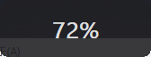
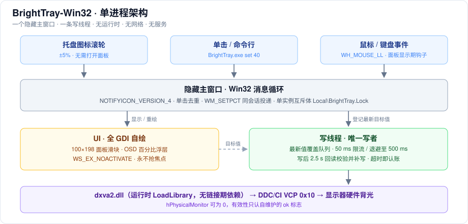
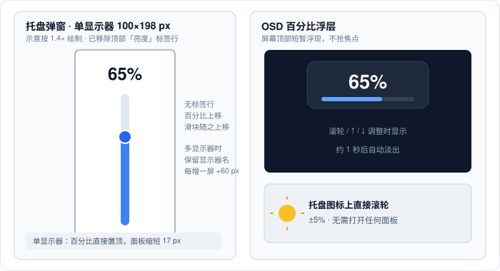

# BrightTray-Win32

    

[](../../actions/workflows/build.yml) [](../../actions/workflows/codeql.yml)

[简体中文说明](README.zh-CN.md)

**A 36 KB, dependency-free brightness tray for Windows.** It changes the *hardware backlight* of external monitors over DDC/CI, and stays under 1 MB of RAM with 5 threads and 0% idle CPU.

Built as a deliberately minimal alternative to [Twinkle Tray](https://github.com/xanderfrangos/twinkle-tray): no Electron, no .NET, no installer, no background service, no telemetry, no network access. One `.exe`, one hidden window, one worker thread.

> **Name**: `BrightTray-Win32`. The suffix distinguishes this pure-C Win32 implementation from two unrelated projects that already use the shorter `BrightTray` name.

## At a glance

| | BrightTray-Win32 | Typical Electron tray app |
| --- | --- | --- |
| Executable | 36 KB | tens of MB |
| Resident memory | 0.24 MB private / 0.5-1.0 MB working set | 100 MB+ |
| Threads | 5 | dozens |
| Runtime | none (system DLLs only) | Chromium / Node / .NET |
| Extra features | none by design | schedules, auto brightness, themes |

The numbers above were measured on one Windows 11 machine with a single 2560x1080 DDC/CI monitor. They are reproducible on that setup, not a cross-platform benchmark. See [docs/DESIGN.md](docs/DESIGN.md) for how the footprint was achieved.

## Features

- **Scroll on the tray icon** to change all monitors by +/-5% without opening anything.
- **Left-click** the sun icon for a small popup with one vertical slider per monitor (100x198 px with one monitor; +60 px width per extra screen, 215 px tall).
- **Scroll inside the popup**, or press **Up / Down**, to move all monitors together; an OSD flashes the percentage at the top of the screen.
- **Esc** or clicking outside closes the popup.
- **Right-click** for *Start with Windows* and *Exit*.
- **Run the exe again** while it is already running: instead of a second process, it just opens the popup.
- **Command line**: `BrightTray.exe set 40`, `BrightTray.exe test`, `BrightTray.exe shot`.
- **Self-check**: `test` enumerates monitors, writes and reads back brightness, restores the original value, and writes `BrightTray_test.log`.

### Why the DDC/CI handling is careful

Writing to a monitor is a slow, lossy, half-duplex I/O channel. Four mechanisms make it behave:

1. **UI never blocks on hardware.** Dragging only stores the *latest* target value and repaints; a background thread performs the actual `SetMonitorBrightness` call. Synchronous writes measured up to 63 ms of UI-thread latency; the async path measures under 1 ms.
2. **Throttling with exponential backoff.** At least 50 ms between two hardware writes; on rejection the interval doubles up to 500 ms. Sending DDC commands too fast makes monitors silently ignore later ones, so the brightness appears stuck.
3. **Read-back verification.** Within 2.5 s after a write the current physical value is read again; a mismatch triggers one retry, and a persistent mismatch is reported as a red "no response" indicator in the popup.
4. **Single writer.** The `set` command hands its request to the already-running instance via a window message instead of opening its own DDC handle. Two processes each holding a handle overwrite each other, which looks like "brightness jumps back by itself".

All four, plus two hard-won Win32 pitfalls (`hPhysicalMonitor` may legitimately be `0`; `NOTIFYICON_VERSION_4` reverses the message layout), are documented in [docs/DESIGN.md](docs/DESIGN.md).

## Screenshots

Unretouched window captures from Windows 11 at 100% DPI, with the English UI:





Scroll on the tray icon and the OSD flashes the new value; click the icon for the slider panel above. The single-monitor popup is deliberately text-free — just a percentage and a slider — so the language difference shows up in the right-click menu, the tray tooltip, multi-monitor column names and the OSD caption (English shows `72%`, Chinese shows `亮度 72%`). All three images are unretouched window captures from the running exe (`BrightTray.exe shot` with `BRIGHTTRAY_LANG=en`), shown at native size, not mockups.

## Architecture and UI



The whole program is one process with one hidden window and one worker thread. Every hardware write goes through that worker; the UI thread never waits on DDC/CI.



The two SVG drawings are labelled schematics, not screenshots. The popup is 100x198 px at 100% DPI with a single monitor (215 px tall when several monitors are shown); the OSD is a brief, non-focus-taking overlay.

## Install and use

1. Download `BrightTray.exe` from the [Releases](../../releases) page (or build it locally).
2. Put it anywhere and run it. There is no installer and nothing is written outside the executable's folder, except the optional `HKCU\Software\Microsoft\Windows\CurrentVersion\Run` value when you enable *Start with Windows*.
3. Windows 11 hides new tray icons inside the `^` overflow area. To keep the icon visible: **Settings -> Personalization -> Taskbar -> Other system tray icons -> enable BrightTray**. If you cannot find the icon, just double-click the exe to open the popup.

```bat
BrightTray.exe            :: resident tray app
BrightTray.exe set 40     :: set all monitors to 40%, then exit (works in shortcuts, Task Scheduler, AutoHotkey)
BrightTray.exe test       :: self-check; writes BrightTray_test.log
BrightTray.exe shot       :: debug: open the popup immediately after startup
```

The interface is English unless Windows is set to Simplified Chinese. To force a language, set `BRIGHTTRAY_LANG=en` or `BRIGHTTRAY_LANG=zh` in the environment before launching.

## Requirements and limitations

- **DDC/CI must be enabled** in the monitor's OSD menu. Most monitors enable it by default.
- **External monitors only.** Laptop internal panels are usually exposed through WMI, and this project deliberately has no WMI backend, so they will show "not supported".
- Not supported: HDR exclusive mode on some monitors, virtual displays, remote desktop sessions, some KVMs and docks that block the DDC/CI channel.
- Windows 7 SP1 or newer; Windows 10/11 recommended. System-DPI aware (mixed-DPI multi-monitor setups may still look soft).
- **Hardware backlight only.** No gamma/software dimming, no auto brightness, no schedule, no contrast/color temperature, no saved settings. The monitor's real current value is always the source of truth.
- A permanently installed low-level mouse hook is required for scroll-over-tray-icon; see [Security and privacy](#security-and-privacy).
- **Two UI languages.** English is the default; a zh-CN Windows automatically gets Simplified Chinese. Set `BRIGHTTRAY_LANG=en` or `BRIGHTTRAY_LANG=zh` to force one (also handy for screenshots). All strings live in one table in `bright.c`; additional translations are welcome.

## Build

The source is a single `bright.c` (about 1,300 lines) plus generated icon data. It is compiled with **TinyCC 0.9.27 win64**; no project file or linker dependencies are needed.

```bat
build.cmd
```

`build.cmd` locates TCC in this order: the `TCC` environment variable, `..\tools\tcc\tcc.exe` (the original development layout), or `tcc.exe` on `PATH`. It writes `build\BrightTray.exe` and prints its SHA-256.

TCC's bundled import libraries lack a few APIs this program uses, so the regenerated `.def` files in `lib/` must be copied into TCC's `lib/` directory (CI does this automatically). They were produced from the export tables of the matching system DLLs by the `mkdef.py` utility. Because the compile is fully deterministic, rebuilding `bright.c` with the same TCC build produces a byte-for-byte identical exe.

`icon_data.h` is generated by `gen_icon.py` (pure Python, no Pillow). It is committed so that building requires only a C compiler.

CI runs [tests](tests/README.md) and a source lint on every push, then builds the exe, verifies it against the committed golden hash, publishes the SHA-256, and attaches the binary plus a build provenance attestation to tagged releases. All third-party actions and the TinyCC archive are pinned by hash. See [.github/workflows/build.yml](.github/workflows/build.yml) and [.github/workflows/codeql.yml](.github/workflows/codeql.yml).

## Security and privacy

- **No network access, no telemetry, no update checker.** The only files written are `BrightTray_test.log` (only in `test` mode) and `BrightTray_crash.txt` (only on a crash).
- A **low-level mouse hook** (`WH_MOUSE_LL`) is installed for the lifetime of the process to implement scroll-over-icon and click-outside-to-close. It observes wheel/press events and does not intercept ordinary clicks. A low-level keyboard hook and three global hotkeys (Esc/Up/Down) exist **only while the popup is visible** and are released on close.
- The popup uses `WS_EX_NOACTIVATE`, so it never steals focus. This is also the reason it stays under 1 MB: a focus-taking window causes Windows to inject IME/TSF DLLs into the process, which raised the thread count from 5 to 12 and the working set to 3-6 MB in earlier builds.
- The `set` command uses a `FindWindow` + `PostMessage` handoff with no sender authentication. It is a local, same-session convenience channel, not a privileged IPC endpoint. See [SECURITY.md](SECURITY.md).

## Comparison

This project is **not** trying to replace the feature sets of [Twinkle Tray](https://github.com/xanderfrangos/twinkle-tray) (Electron, DDC/CI + WMI, schedules, hotkeys, 20+ languages) or [Monitorian](https://github.com/emoacht/Monitorian) (C#/WPF, contrast, ambient light sensor). It targets one specific complaint: *a tray utility should not cost 100 MB of RAM*.

Other small native tools worth looking at: [lumos_ddc](https://github.com/sfortis/lumos_ddc) (pure C Win32, DDC/CI + WMI, ~200 KB), [MonitorBrightnessControl](https://github.com/valinet/MonitorBrightnessControl) (C tray daemon, MIT), and [ddcutil](https://github.com/rockowitz/ddcutil) (the Linux C reference for DDC/CI).

## Contributing

Bug reports are especially welcome for monitor models that reject DDC writes. Please read [CONTRIBUTING.md](CONTRIBUTING.md) and include the output of `BrightTray.exe test`.

If your monitor works, please add it to the [Verified monitors](docs/VERIFIED-MONITORS.md) table with the *Verified monitor* issue form. DDC/CI behaviour varies a lot between panels, and that table is the only way for other people to know before downloading.

## Further reading

- [DDC/CI pitfalls: five decisions and two Win32 traps](docs/DDC-CI-PITFALLS.md) — why writing to a monitor needs a worker thread, throttling, read-back and a single writer, with the measurements behind each choice.
- [docs/DESIGN.md](docs/DESIGN.md) — footprint measurements, the full write pipeline, and known technical debt.

## License

[MIT](LICENSE). Third-party notices are in [NOTICE.md](NOTICE.md).
