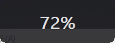
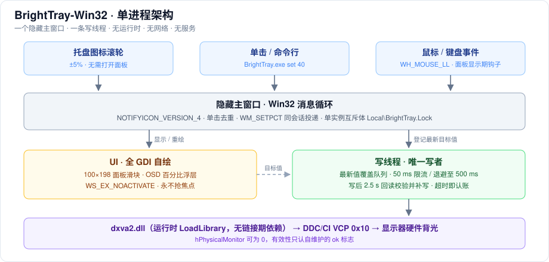
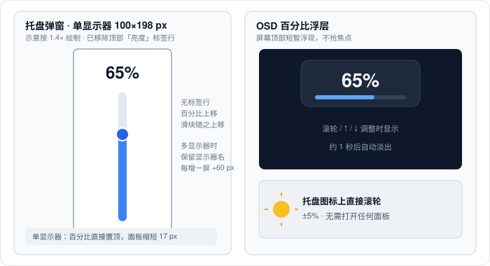

# BrightTray-Win32 · 中文说明

[English README](README.md)

极轻量的 Windows 屏幕亮度托盘工具，**36 KB 单文件、免安装、无运行时**，通过 DDC/CI 直接调节显示器硬件背光。常驻内存 0.24 MB（私有工作集）/ 0.5–1.0 MB（工作集），5 线程，空闲 CPU 0%。

它是 [Twinkle Tray](https://github.com/xanderfrangos/twinkle-tray) 的极简替代品：没有 Electron、.NET、安装器、后台服务、联网或遥测。代价也很明确——不做自动亮度、色温、日程曲线等功能。

> **命名说明**：GitHub 上已有两个无关的 `BrightTray` 仓库。本项目定名 **BrightTray-Win32**，后缀表明这是纯 C / Win32 实现。

## 它怎么做到的

| 做法 | 说明 |
| --- | --- |
| 纯 C + Win32 API | 无 Electron / .NET / Python 运行时，无 JS 引擎，无打包框架；`dxva2.dll` 运行时动态加载 |
| 单进程 5 线程 | 一个隐藏主窗口 + 托盘图标 + 一条写硬件的后台线程；无轮询、无定时任务 |
| 界面全 GDI 自绘 | 不加载公共控件库，面板就是一个窗口，滑块是画出来的 |
| 写硬件不上 UI 线程 | 拖动时 UI 只登记「最新亮度」并重绘，DDC 写入交给后台线程异步追。实测同步写 UI 线程延迟最高 63 ms（拖不动 + 忙碌光标），异步后 < 1 ms |
| DDC 写入限流 | 两次硬件写入至少间隔 50 ms，被拒则间隔翻倍退避至 500 ms。命令太密显示器会直接忽略后续命令，亮度就「卡住不动」 |
| 写完回读校验 | 写后 2.5 秒内回读实物，值不对自动补写，连补两次仍不对则面板标红「无响应」；超时即认账，避免把用户手动改的亮度抢回来 |
| 单写者 | `set` 不自己写硬件，把请求投递给已运行实例。两个进程各拿一个 DDC 句柄互相覆盖，是亮度「自己跳回去」的常见原因 |
| 面板不抢焦点 | `WS_EX_NOACTIVATE` + `SW_SHOWNOACTIVATE`，键盘由「显示期间的低级键盘钩子 + Esc/↑/↓ 热键」双通道接收，关闭即释放 |

**关于内存台阶的根因**：早期版本里面板为了接收 Esc / ↑ / ↓ 必须拿到焦点，而窗口一旦获得焦点，Windows 就会把输入法框架注入进程（实测 QQPinyin.ime 13.5 MB、MSCTF、textinputframework），线程 5→12、工作集跳到 3–6 MB 且不再回落。改用 NOACTIVATE 后，打开面板实测模块 28→29、线程仍是 5、私有提交约 2.3 MB，输入法只剩系统自带的 MSCTF。

## 真实截图

Windows 11、100% DPI、英文界面下的窗口实拍（未做修饰）：





图片由运行中的程序（`BrightTray.exe shot` 配合 `BRIGHTTRAY_LANG=en`）按原始像素直接截取，不是示意图。单显示器面板本身只有百分比和滑块、没有文字，所以语言差异主要体现在右键菜单、托盘提示、多显示器列名和 OSD 文案（英文 `72%`，中文「亮度 72%」）。

## 架构与界面



全局只有一个进程、一个隐藏主窗口、一条写线程；所有硬件写入都经写线程排队，UI 线程不等 DDC/CI。



两张 SVG 是带标注的矢量示意图，不是截图。面板在 100% DPI 下单显示器为 100×198 像素；多显示器时高度 215 像素。

## 实测数据

测试环境：Windows 11、2560×1080、单台 DDC/CI 外接显示器。**这是单机实测值，不是跨平台基准测试。**

```
WorkingSet64   : 0.5 – 1.0 MB   (刚启动 0.97，开关过面板后回落到 0.5)
PrivateBytes   : 2.1 MB         (提交量，含保留空间)
线程 / 句柄    : 5 / 153
CPU            : 空闲 0%
可执行文件    : 36,352 字节，仅依赖系统 DLL
```

连续开关面板 40 轮、滚轮 20 次后：模块数稳定 29、线程 5、句柄 125→128 后平稳、私有提交 2328→2332 KB（无泄漏）。单显示器面板 100×198 像素；多显示器时每增一屏宽 60 像素、高度 215 像素。

## 使用

| 操作 | 效果 |
| --- | --- |
| **光标停在托盘图标上滚滚轮** | **直接调所有显示器亮度 ±5%，不用打开面板**（最常用） |
| 左键单击托盘太阳图标 | 弹出亮度面板；多显示器时每屏一列 |
| 拖动竖直滑块 | 实时调节该显示器亮度（0–100%） |
| 面板内滚轮 / ↑ / ↓ | 所有显示器同时 ±5%，屏幕顶部闪现百分比 |
| Esc 或点击面板外 | 关闭面板 |
| 右键托盘图标 | 开机自启动（可勾选）、退出 |
| 再次双击 exe | 已运行时不会开第二个进程，直接弹出面板 |

```bat
BrightTray.exe            :: 常驻托盘
BrightTray.exe set 40     :: 把所有显示器设为 40% 后退出
BrightTray.exe test       :: 自检（枚举显示器、读写亮度验证），写入 BrightTray_test.log
BrightTray.exe shot       :: 调试用：启动后立即弹出面板
```

界面默认英文，简体中文（zh-CN）系统自动显示中文。可用环境变量 `BRIGHTTRAY_LANG=en` / `zh` 强制指定，截英文图时很有用。

`set` 可用于快捷方式、计划任务、AutoHotkey，例如做「一键夜间模式」：`BrightTray.exe set 20`。

**Windows 11 提示**：新托盘图标默认收进 `^` 隐藏区。设置 → 个性化 → 任务栏 → 其他系统托盘图标 → 打开 BrightTray。找不到图标时直接双击 exe 即可弹出面板。

## 排障

| 现象 | 处理 |
| --- | --- |
| 点托盘图标没反应 | 先看任务管理器里有没有 `BrightTray`；没有就重新启动，有就退出后重启一次 |
| 托盘里有两个太阳图标 | 强制结束进程留下的「幽灵图标」，鼠标划过后自动消失 |
| 面板弹出但不跟手 | 显示器 DDC/CI 响应慢；换根线或关掉显示器节能模式 |
| 某块屏显示「不支持」 | 在显示器 OSD 菜单里打开 DDC/CI；HDR 独占、虚拟屏、远程桌面调不了 |
| 数字在动但亮度不变 | 面板上变红显示「无响应」（单显示器在百分比位置，多显示器在顶部标签行），说明显示器拒收 DDC 命令；先复位显示器 |
| 反复「无响应」 | DDC/CI 通道卡住：拔显示器电源 10 秒再插回，芯片复位后恢复 |

## 兼容性

- **外接显示器**：需开启 DDC/CI（多数默认开启）。
- **笔记本内屏**：多数只暴露 WMI 接口，本项目**没有 WMI 后端**，会显示「不支持」。这是与 Twinkle Tray / Monitorian / Lumos 相比最大的功能差距。
- **系统**：Windows 7 SP1 及以上，10/11 效果最佳；已声明 System-DPI 感知，混合缩放的多屏环境仍可能发虚。
- **不支持**：HDR 独占模式下的部分显示器、虚拟显示器、远程桌面会话、部分阻断 DDC/CI 的 KVM / 扩展坞。

## 构建

源码是单个 `bright.c`（约 1300 行）+ 生成的 `icon_data.h`，用 **TinyCC 0.9.27 win64** 编译，无需工程文件或链接期依赖：

```bat
build.cmd
```

`build.cmd` 依次从 `%TCC%`、`..\tools\tcc\tcc.exe`、`PATH` 查找编译器，输出到 `build\BrightTray.exe` 并打印 SHA-256。

TCC 自带导入库缺少部分 API，需要用 `lib/` 里重新生成的 `.def` 覆盖 TCC 的 `lib/` 目录（CI 自动完成）。这些 `.def` 由 `mkdef.py` 从系统 DLL 导出表生成。由于编译过程完全确定，同一 TCC 版本重新编译可得到**逐字节相同**的 exe。`icon_data.h` 由 `gen_icon.py` 生成（纯 Python，无 Pillow 依赖），已随仓库提交，因此构建只需要一个 C 编译器。

CI 在每次 push 时先跑[仓库测试与源码检查](tests/README.md)，再编译并与仓库里固定的 golden 哈希逐字节比对，公布 SHA-256；打 tag 时把二进制与构建来源证明（provenance attestation）一起附到 Release。第三方 Action 与 TinyCC 压缩包都按哈希固定，详见 [build.yml](.github/workflows/build.yml) 与 [codeql.yml](.github/workflows/codeql.yml)。

## 安全与隐私

- **不联网、无遥测、无更新检查**。除 `test` 模式的 `BrightTray_test.log` 和崩溃时的 `BrightTray_crash.txt` 外不写文件。
- 为实现「图标上滚轮调亮度」和「点面板外收起」，进程生命周期内常驻一个 `WH_MOUSE_LL` 低级鼠标钩子；它只读滚轮/按下事件，不拦截普通点击。低级键盘钩子与 Esc/↑/↓ 全局热键**仅在面板显示期间**存在，关闭即释放。
- 面板使用 `WS_EX_NOACTIVATE`，从不抢焦点。
- `set` 通过 `FindWindow` + `PostMessage` 投递消息，无发送方校验，属于同会话内的本地便利通道，不是特权 IPC。详见 [SECURITY.md](SECURITY.md)。

## 两个坑（改代码前请先看）

1. **`hPhysicalMonitor` 可能等于 0，不能拿它判空**。`GetPhysicalMonitorsFromHMONITOR` 在某些显卡/驱动组合下返回的句柄就是 0（索引 0），读写 DDC 完全正常。早期代码写了 `if (!m->hpm) return FALSE;`，每次写硬件都被静默跳过，表现为「拖滑块数字在动、屏幕一点不变」。有效性只能看自维护的 `ok` 标志。
2. **托盘图标协议版本不同，报文布局正好相反**。注册 `NOTIFYICON_VERSION_4` 后 `wp` = 坐标、`lp` 低字 = 事件；旧协议相反。混用的结果是「点图标永远没反应」。且 v4 下一次单击会连发 `WM_LBUTTONUP` 和 `NIN_SELECT`，必须去重，否则「刚打开就被自己关掉」。

更多设计决策与踩坑记录见 [DDC/CI 踩坑长文](docs/DDC-CI-PITFALLS.md) 与 [docs/DESIGN.md](docs/DESIGN.md)。

## 已知限制

- 拖动时只把「最新值」交给后台线程，中间态直接丢弃；松手后一般 100 ms 内落到目标值。
- 常驻低级鼠标钩子是换取「免开面板调亮度」的代价。
- 图标被 Win11 完全收进隐藏区且浮层未展开时，系统不提供图标位置，滚轮调亮度不可用；面板和 `set` 不受影响。
- 只调硬件背光，不做 gamma 软件调光（那会牺牲对比度）。
- 面板出现在鼠标所在显示器工作区，暂不支持自定义位置与尺寸。
- 亮度值不持久化，始终以显示器当前实际值为准（外部改动后重开面板会自动同步）。
- 界面目前只有英文与简体中文两种文案，切换依据系统 UI 语言或 `BRIGHTTRAY_LANG` 环境变量；其他语言欢迎贡献翻译。

## 许可证与第三方声明

[MIT](LICENSE)。第三方声明见 [NOTICE.md](NOTICE.md)。欢迎提交 issue（尤其是拒收 DDC 写入的显示器型号），请附 `BrightTray.exe test` 的输出，见 [CONTRIBUTING.md](CONTRIBUTING.md)。如果你的显示器工作正常，也请用「Verified monitor」模板把它加进 [已验证机型表](docs/VERIFIED-MONITORS.md)。
